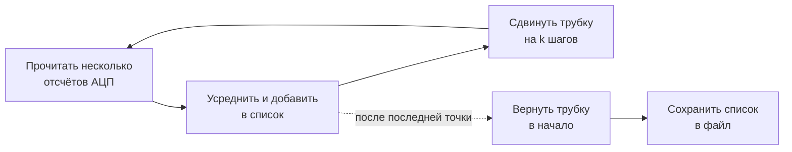

---
tags:
  - теория
  - лр1
нагрузка, мин: 8
---

Мы знаем, что измерять — давление торможения в точках сечения — и как из него получить скорость и расход. Осталось разобраться, как установка делает это автоматически: перемещает трубку Пито поперёк струи и снимает показания в каждой точке.
^intro

## Состав установки

![[т1.4 Схема установки.png|420]]

*Принципиальная схема: источник струи, трубка Пито на подвижной каретке, датчик давления и компьютер.*

Основные элементы установки:

- **воздуходувка с коническим соплом** создаёт струю воздуха; диаметр среза сопла 15 мм;
- **трубка Пито** — тонкая трубка, направленная навстречу потоку, — ловит давление торможения;
- **каретка с шаговым двигателем** перемещает трубку поперёк струи;
- **датчик давления с 24-битным АЦП** переводит разность давлений в число;
- **компьютер Raspberry Pi** с платой расширения управляет двигателем и читает АЦП;
- **цифровой манометр** нужен для калибровки датчика.

![[т1.4 Установка сверху.jpg|420]]

*Установка сверху. Вверху воздуходувка в держателе, под ней сопло. Трубка Пито лежит вдоль продольной шкалы 0–80 мм. Внизу каретка с поперечной линейкой и зубчатой рейкой, под ней шаговый двигатель.*

## Две шкалы и два движения

Трубку двигают в двух направлениях, и у каждого своя шкала.

| Движение | Чем двигают | По какой шкале | Зачем |
| --- | --- | --- | --- |
| вдоль струи | рукой, между профилями | продольная шкала 0–80 мм, ноль — срез сопла | выбрать **сечение**: на каком расстоянии от сопла снимать профиль |
| поперёк струи | шаговым двигателем, во время профиля | поперечная линейка на каретке | пройти струю от края до края и снять **профиль** |

Сечение выставляют один раз перед профилем и во время записи не трогают. Поперёк трубку ведёт скрипт.

## Воздуходувка

Струю создаёт небольшая мощная воздуходувка. У неё четыре режима. Скорость на срезе сопла:

| Режим | Давление торможения у сопла | Скорость у сопла |
| :---: | :---: | :---: |
| 1 | ≈ 530 Па | ≈ 30 м/с |
| 2 | ≈ 745 Па | ≈ 35 м/с |
| 3 | ≈ 1050 Па | ≈ 42 м/с |
| 4 | ≈ 1590 Па | ≈ 51 м/с |

Работа выполняется **в первом режиме**. В четвёртом поток заметно пульсирует. Режим выбирают один раз и не меняют, пока не сняты все сечения, иначе профили нельзя сравнивать.

Цифровой манометр рассчитан на меньшие давления и при полной мощности зашкаливает. Поэтому для калибровки поток ослабляют: прикрывают вход воздуходувки листом бумаги, см. [[п1.2 Калибровка датчика давления и перемещения#^intro|п1.2]].

## Шаговый двигатель

![[Шаговый двигатель#^def]]

Двигатель подключён к Raspberry Pi через драйвер тремя выводами: направление вращения, разрешение работы и шаг. Каждый импульс на выводе шага поворачивает вал на один шаг. На валу шестерня, она двигает зубчатую рейку каретки, и трубка смещается поперёк струи. Сколько миллиметров приходится на один шаг, заранее неизвестно, это находят калибровкой: сдвигают трубку на известное число шагов и смотрят перемещение по поперечной линейке. На установке в лаборатории 500 шагов — это около 18 мм, то есть **около 0,036 мм на шаг**, а 1 мм — 28 шагов.

Функции управления двигателем есть в `jetFunctions.py`:

| Функция | Что делает |
| --- | --- |
| `initStepMotorGpio()` | настраивает выводы двигателя на выход |
| `stepForward(n)` | делает n шагов вперёд |
| `stepBackward(n)` | делает n шагов назад |
| `deinitStepMotorGpio()` | выключает выводы и освобождает GPIO |

Скрипт `jetMover.py` позволяет двигать трубку вручную из терминала: ввести число шагов, посмотреть текущее положение, обнулить его. С его помощью трубку ставят в начальную точку перед измерением.

Механика тугая: двигатель тянет рейку с усилием. Поэтому каретку нельзя упирать в край хода. Двигатель не знает, где кончается рейка, и, упёршись, пропускает шаги, а положение трубки перестаёт совпадать со счётчиком.

## Как снимается профиль

Программа повторяет одну и ту же последовательность для каждой точки сечения:

Усреднение нужно потому, что струя турбулентная и давление в точке пульсирует. Среднее по многим отсчётам даёт среднюю по времени картину, которая и описывается формулами из [[т1.2 Расход и поток вектора#^intro|т1.2]].

Так получают профили в нескольких сечениях: 0, 10, 20 … 70 мм от сопла, а если есть время — и 80 мм.

## Датчик давления и АЦП

Давление измеряет модуль датчика с 24-битным АЦП [[HX710B]]. Датчик подключён к разъёму на плате расширения. Raspberry Pi читает его по SPI функцией `getAdc()` из `jetFunctions.py`; выводы GPIO 9, 10, 11 перед этим переводят под SPI, как описано в [[о3 Raspberry Pi и АЦП#Настройка выводов под SPI|о3]].

![[т1.4 Плата ant-lab.jpg|360]]

*Raspberry Pi с платой расширения ant-lab. Белый модуль сверху — драйвер шагового двигателя, справа разъёмы двигателя и датчика давления.*

| Параметр | Значение |
| --- | --- |
| Разрядность | 24 бита |
| Отсчёт без потока | около 208 000–211 000, плавает |
| Чувствительность | около 22 отсчётов на паскаль |
| Новых результатов в секунду | 10 |
| Датчик: OUT / SCK | GPIO 9 / GPIO 11 (SPI) |
| Двигатель: направление, разрешение, шаг | GPIO 24, 25, 26 |

Отсчёт линейно связан с давлением, коэффициенты находят калибровкой. Три особенности 24-битного АЦП важны для всей работы:

- **Новый результат появляется только 10 раз в секунду.** Если читать АЦП чаще, приходят повторы того же числа. Поэтому в каждой точке профиля читают 10–20 отсчётов с паузой около 0,05 с, а не сотни подряд.
- **Ноль плавает.** От записи к записи отсчёт без потока смещается на сотни единиц, это больше 10 Па. Поэтому ноль давления для каждого профиля берут по его краям, где трубка стоит вне струи, а калибровка нужна только для наклона — паскалей на отсчёт.
- **Датчик отпускает давление не сразу.** После того как трубка прошла через струю, показания возвращаются к нулю за несколько секунд, и край профиля после струи бывает на 10–25 Па выше края до неё. Помогает пауза после каждого сдвига трубки, а при обработке ноль берут не одним числом, а прямой между левым и правым краем профиля.

Изредка АЦП отдаёт сбойное число, на порядок больше остальных. Такие точки отбрасывают при обработке.

<!-- навигация -->

---

| Предыдущий раздел | К работе | Следующий раздел |
| :--- | :---: | ---: |
| [[т1.3 Трубка Пито и уравнение Бернулли#^intro\|← т1.3 Трубка Пито и уравнение Бернулли]] | [[лр1 Расход затопленной струи#^intro\|лр1]] | [[п1.1 Скрипт измерений струи#^intro\|п1.1 Скрипт измерений струи →]] |
