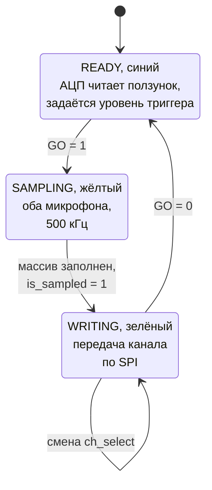

---
tags:
  - теория
  - лр4
нагрузка, мин: 8
---

Задержка звука между микрофонами — около 3,4 мс, а разница задержек в воздухе и в выдохе — несколько сотых миллисекунды. Чтобы её заметить, сигналы надо записывать очень часто и запускать запись точно в момент хлопка. Как устроена установка и чем она записывает сигналы?
^intro

## Труба

![[т4.5 Схема установки.jpeg]]

Основная часть установки — стальная труба квадратного сечения (1). В её стенки на расстоянии L = 1158 мм друг от друга вставлены микрофоны (2), а также шланг, через который трубу заполняют выдыхаемым воздухом. Микрофоны через усилители подключены к записывающему прибору (3).

![[т4.5 Отверстие под микрофон.jpeg|420]]

![[т4.5 Шланг и мундштук.jpeg|260]]

Чтобы заполнить трубу выдохом, её конец закрывают магнитом-заглушкой, в шланг вставляют одноразовый мундштук и выдыхают в трубу. Потом заглушку снимают и хлопают в ладоши у открытого конца.

## Вариант 1. Осциллограф

Микрофоны подключены к двум каналам цифрового осциллографа. Осциллограф непрерывно оцифровывает сигналы, а сохраняет картинку на экране по событию.

![[Триггер осциллографа#^def]]

Триггер настраивают на первый канал, к которому подключён ближний к хлопку микрофон. Когда звук хлопка доходит до него, сигнал пересекает уровень триггера, и осциллограф «замораживает» картинку: часть до события и часть после. Задержку между сигналами измеряют курсорами на экране.

Осциллограф подключён к сети лаборатории по Ethernet. Снимок его экрана можно скачать HTTP-запросом страницы `http://<ip-адрес>/Image.png`, это делает скрипт `soundScreenshot.py` из стартового набора.

![[п4.3 Осциллограмма, воздух.png|480]]

На снимке развёртка 1 мс на деление, курсоры стоят на первых пиках сигналов, и в правом верхнем углу видна разность времён Δ = 3,36 мс. Курсор двигается шагами по 10 мкс. При τ ≈ 3,4 мс это ошибка около 1 м/с в скорости звука — столько же, сколько даёт 1 % CO₂. Точность варианта ограничена именно этим.

## Вариант 2. Микроконтроллер

В новой версии сигналы оцифровывает микроконтроллер Atmel с собственным АЦП, а Raspberry Pi только командует и забирает данные по SPI. Микроконтроллер переключается между тремя состояниями, каждое показано своим светодиодом:

- **READY.** Пока на выводе GO ноль, АЦП читает ползунок на плате и задаёт им уровень триггера.
- **SAMPLING.** Когда Raspberry Pi подаёт единицу на GO, микроконтроллер одновременно оцифровывает оба микрофона с частотой 500 кГц. Первые 500 ячеек массива он заполняет по кругу, затирая старые данные, и после каждого отсчёта сравнивает первый канал с уровнем триггера. Когда сигнал превысил уровень, массив дописывается до конца, до 5000 отсчётов на канал. Так в записи остаётся немного «до хлопка» и всё, что после.
- **WRITING.** Микроконтроллер читает вывод ch_select и передаёт по SPI канал с этим номером. Когда передача закончена, он выставляет единицу на is_written. При смене ch_select передаёт другой канал. В READY возвращается, только когда GO снова ноль.

| Сигнал | GPIO Raspberry Pi | Направление для Raspberry Pi |
| --- | :---: | --- |
| SPI_CS | 8 | выход, опускается и поднимается вручную |
| SPI_MISO | 9 | вход, `raspi-gpio set 9 a0` |
| SPI_SCLK | 11 | выход, `raspi-gpio set 11 a0` |
| GO | 17 | выход |
| is_sampled | 27 | вход |
| ch_select | 22 | выход |
| is_written | 23 | вход |

Частота 500 кГц означает отсчёт каждые 2 мкс: задержка известна в пять раз точнее, чем по курсору осциллографа. Окно записи 5000 отсчётов — 10 мс, задержка 3,4 мс в него помещается целиком. Сигналы сохраняются массивами чисел, и задержку находит программист по методу из [[т4.4 Время пролёта звука между микрофонами#^intro|т4.4]].

<!-- навигация -->

---

| Предыдущий раздел | К работе | Следующий раздел |
| :--- | :---: | ---: |
| [[т4.4 Время пролёта звука между микрофонами#^intro\|← т4.4 Время пролёта звука между микрофонами]] | [[лр4 Скорость звука в газовой среде#^intro\|лр4]] | [[п4.1 Подготовка установки звука#^intro\|п4.1 Подготовка установки звука →]] |
