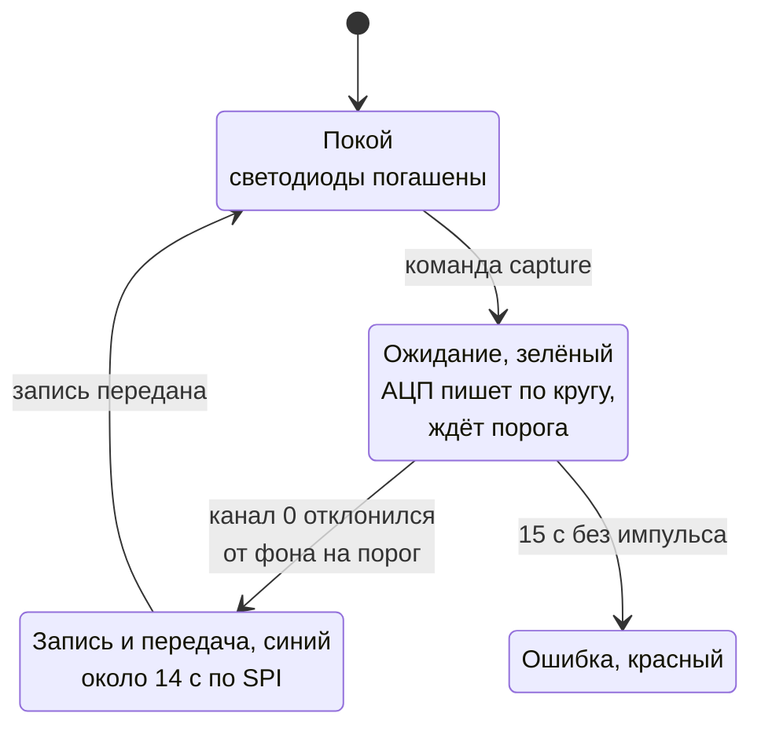

---
tags:
  - теория
  - лр4
нагрузка, мин: 8
---

Задержка звука между микрофонами — около 3,4 мс, а задержки в воздухе и в выдохе различаются всего на несколько сотых миллисекунды. Чтобы заметить такую разницу, сигналы надо записывать очень часто и начинать запись в момент хлопка. Как устроена установка и чем она записывает сигналы?
^intro

## Труба

![[т4.5 Схема установки.jpeg]]

Основная часть установки — стальная труба квадратного сечения (1). В её стенки на расстоянии **L** = 1158 мм друг от друга вставлены микрофоны (2), а также шланг, через который трубу заполняют выдыхаемым воздухом. Микрофоны через усилители подключены к записывающему прибору (3).

![[т4.5 Отверстие под микрофон.jpeg|420]]

![[т4.5 Шланг и мундштук.jpeg|260]]

Чтобы заполнить трубу выдохом, её конец закрывают магнитом-заглушкой, в шланг вставляют одноразовый мундштук и выдыхают в трубу. Потом заглушку снимают и хлопают в ладоши у открытого конца.

## Измеритель на Pico

Сигналы микрофонов оцифровывает [[Raspberry Pi Pico 2]] — небольшая плата с микроконтроллером RP2350 и собственным 12-битным АЦП. В неё уже записана программа, и Pico работает как готовый двухканальный измеритель: Raspberry Pi отправляет ему текстовые команды и забирает запись по SPI. Программировать сам Pico не нужно.

>[!note] В пособии
>В печатном пособии 2023 года сигналы записывал цифровой осциллограф, а задержку измеряли курсорами на его экране с шагом 10 мкс. Pico делает отсчёт каждые 4 мкс и отдаёт запись числами, поэтому задержку можно найти точнее и обработать программой.

Запись начинается по событию — по триггеру:

![[Триггер#^def]]

Микрофон 0 подключён к входу GP26 Pico, микрофон 1 — к GP27. **Микрофон 0 — ближний к открытому концу трубы**, у которого хлопают.

### Как проходит запись

1. Функция `capture()` из `soundPico.py` на Raspberry Pi отправляет Pico команду `capture 20 15000`: порог 20, ожидание не дольше 15 000 мс. Pico отвечает `armed`, загорается **зелёный** светодиод — можно хлопать.
2. Пока импульса нет, АЦП непрерывно оцифровывает оба микрофона и записывает отсчёты по кругу, затирая старые. После каждого отсчёта Pico сравнивает микрофон 0 с его средним фоновым уровнем.
3. Когда сигнал микрофона 0 отклонился от фона больше чем на порог — вверх или вниз, — срабатывает триггер. Pico дописывает запись до конца, и загорается **синий** светодиод. В записи остаются 512 отсчётов до срабатывания — предыстория — и всё, что после. Предыстория нужна потому, что слабое начало импульса проходит раньше, чем отклонение дорастает до порога: на нашей установке импульс начинается примерно за 200 отсчётов, 0,8 мс, до срабатывания.
4. Готовая запись передаётся на Raspberry Pi по SPI, это около 14 секунд. Функция возвращает два массива — микрофон 0 и микрофон 1, — а скрипт экспериментатора сохраняет их в два файла, по одному коду АЦП в строке. Светодиоды гаснут.
5. Если за 15 секунд импульса не было или произошёл сбой, загорается **красный** светодиод. Он горит до следующего запуска.

Порог задаётся в кодах АЦП **относительно фона**, а не абсолютным значением. Фоновый уровень микрофонов — коды около 850–950 из 0–4095, и это не громкость. Порог передают функции `capture()`.

### Время в записи

| Параметр | Значение |
| --- | --- |
| Частота отсчётов | 250 кГц на каждый канал, шаг 4 мкс |
| Сдвиг каналов | микрофон 1 измеряется на 2 мкс позже микрофона 0 |
| Длина записи | 4096 отсчётов на канал, 16,4 мс |
| Предыстория | первые 512 отсчётов, 2,05 мс до срабатывания триггера |
| АЦП | 12 бит, коды 0–4095 |

АЦП у Pico один, и он измеряет каналы по очереди: микрофон 0, через 2 мкс микрофон 1, ещё через 2 мкс снова микрофон 0. Поэтому отсчёт номер i микрофона 1 сделан на 2 мкс позже отсчёта номер i микрофона 0. Если задержку нашли сдвигом в **N** отсчётов, то

$$
\tau = \frac{N}{250\,000\ \text{Гц}} + 2\ \text{мкс} = N \cdot 4\ \text{мкс} + 2\ \text{мкс}.
$$

Для **τ** ≈ 3,36 мс сдвиг около 840 отсчётов. Окно записи 16,4 мс: задержка помещается в него целиком, вместе с отражениями.

Скорость SPI на шаг времени не влияет: короткая запись сначала целиком сохраняется в памяти Pico и только потом медленно передаётся.

Как шаг 4 мкс сказывается на точности скорости звука и доли CO₂ — в [[т4.4 Время пролёта звука между микрофонами#Точность метода|т4.4]].

### Соединение Raspberry Pi и Pico

Платы уже соединены, таблица нужна, чтобы проверить провода.

| Сигнал | GPIO Raspberry Pi | Контакт Raspberry Pi | Pico 2 | Контакт Pico |
| --- | :---: | :---: | :---: | :---: |
| MOSI, команды от Raspberry Pi | 10 | 19 | GP19 | 25 |
| MISO, данные от Pico | 9 | 21 | GP16 | 21 |
| SCLK, такты | 11 | 23 | GP18 | 24 |
| CS, выбор Pico | 8 | 24 | GP17 | 22 |
| Общая земля | GND | например, 6 | GND | например, 23 |

Номер GPIO не совпадает с номером контакта на разъёме. Ведущий в обмене — Raspberry Pi: она подаёт такты, отправляет команду по MOSI и забирает ответ по MISO. Выводом CS функции управляют сами. Параметры обмена — SPI0.0, mode 0, 10 кГц — уже записаны в `soundPico.py`.

<!-- навигация -->

---

| Предыдущий раздел | К работе | Следующий раздел |
| :--- | :---: | ---: |
| [[т4.4 Время пролёта звука между микрофонами#^intro\|← т4.4 Время пролёта звука между микрофонами]] | [[лр4 Скорость звука в газовой среде#^intro\|лр4]] | [[п4.1 Подготовка установки звука#^intro\|п4.1 Подготовка установки звука →]] |
