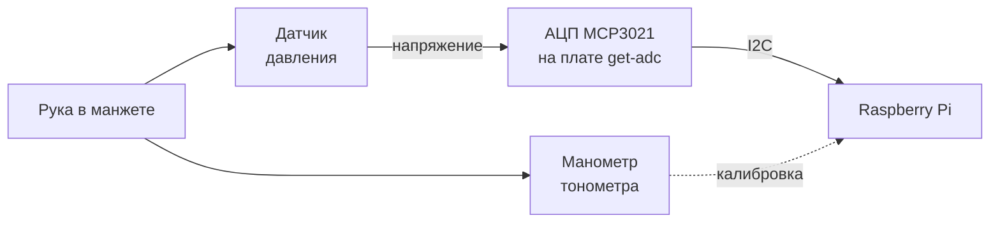

---
tags:
  - теория
  - лр5
нагрузка, мин: 5
---

Обычный механический тонометр показывает давление стрелкой, и записать его стрелку компьютер не может. Что нужно добавить к тонометру, чтобы давление в манжете превратилось в поток чисел на Raspberry Pi?
^intro

## Тонометр

![[т5.3 Тонометр.png|420]]

Механический тонометр состоит из манжеты, груши для накачки воздуха с клапаном для его спуска и стрелочного манометра. Манометр показывает давление в манжете в мм рт. ст. и служит эталоном при калибровке.

## Датчик давления

![[т5.3 Датчик давления.png|420]]

К воздушной магистрали тонометра через тройник подключён датчик давления. Он выдаёт напряжение, которое растёт с давлением в манжете. Датчик и манометр соединены с одним и тем же объёмом воздуха, поэтому видят одно и то же давление.

## АЦП и компьютер

Датчик подключается к разъёму блока 5 В платы get-adc, с которой вы работали на занятии по АЦП. Его напряжение оцифровывает 10-битный АЦП MCP3021 и передаёт отсчёты на Raspberry Pi по шине I2C. Это тот же АЦП и тот же драйвер `mcp3021_driver.py`, что на занятии: отсчёт от 0 до 1023, где 1023 соответствует 5 В.

## Частота дискретизации

Пульс 60–120 ударов в минуту — это 1–2 удара в секунду, а форма одной пульсовой волны занимает доли секунды. Чтобы увидеть волну подробно, нужно хотя бы несколько десятков отсчётов в секунду. Скрипт без задержек в цикле читает MCP3021 около 1800 раз в секунду, этого с большим запасом хватает.

## Чувствительность и шум квантования

На установке курса давление 40 мм рт. ст. даёт около 124 отсчётов, а 160 мм рт. ст. — около 417. На один отсчёт приходится примерно 0,41 мм рт. ст.

Пульсовая волна в манжете — всего 0,5–1 мм рт. ст., то есть 1–2,5 отсчёта АЦП. Значение давления на записи меняется не плавно, а ступеньками по 0,41 мм рт. ст., и пульсовая волна едва выступает над этими ступеньками. Такое ступенчатое искажение называют шумом квантования. Его приходится сглаживать при обработке, см. [[т5.4 Выделение пульсовой волны#Шум квантования|т5.4]].

<!-- навигация -->

---

| Предыдущий раздел | К работе | Следующий раздел |
| :--- | :---: | ---: |
| [[т5.2 Осциллометрический метод#^intro\|← т5.2 Осциллометрический метод]] | [[лр5 Визуализация пульсовой волны#^intro\|лр5]] | [[т5.4 Выделение пульсовой волны#^intro\|т5.4 Выделение пульсовой волны →]] |
